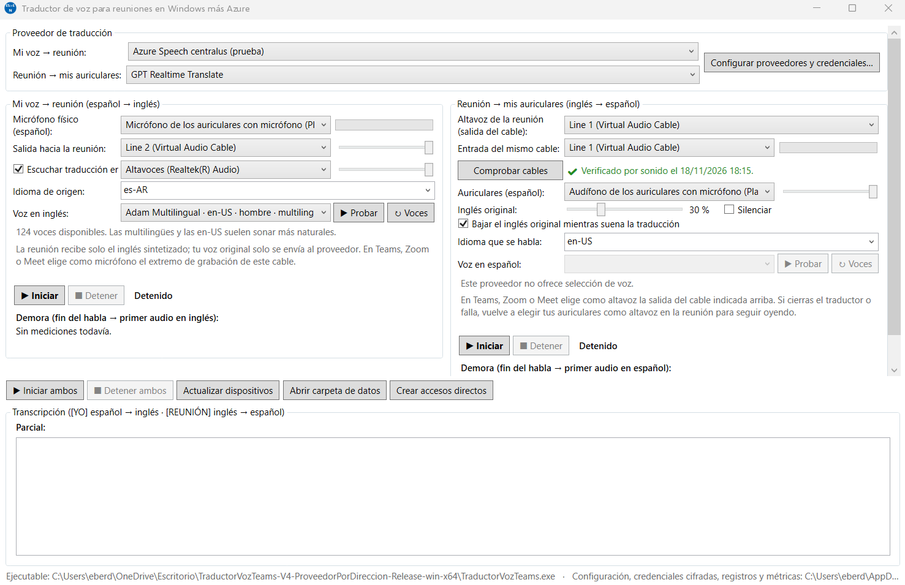

# Traductor de voz para reuniones en Windows más Azure



## Por qué lo hice

Conozco a un montón de profesionales excelentes que se quedan callados en una reunión, o que ni se anotan a un desafío nuevo, por la barrera del idioma. No es falta de capacidad: es no poder mantener una conversación fluida en otra lengua.

La traducción en tiempo real ya existe, pero nadie la acercó de forma simple, compatible con cualquier app de videollamada (Teams, Zoom, Meet o la que uses) para que la charla siga sin cortes.

Armé este traductor para eso, con **Azure AI Foundry**. Virtual Audio Cable hace de puente: un cable virtual lleva tu voz traducida a la reunión y trae el audio de la reunión a tus auriculares.

- **Funciona en Windows con cualquier app de videollamada:** Teams, Zoom, Google Meet, WhatsApp o la que uses, sin depender de una plataforma en particular.
- **Traduce en las dos direcciones:** tu voz sale traducida hacia la reunión, y lo que dicen los demás te llega traducido a los auriculares.
- **Usa Azure AI Foundry:** Azure AI Speech y GPT Realtime Translate; podés elegir cuál usar en cada dirección.
- **De fábrica, español ⇄ inglés; con Speech, también otros idiomas.** Los campos de idioma de origen son editables (código BCP-47). Con Azure AI Speech podés apuntar a otro idioma destino. GPT Realtime, en esta versión, traduce entre español e inglés.

Va por la **versión 4** y lo comparto abierto porque creo que le puede servir mucho a la comunidad. Si lo usás, si encontrás un error o se te ocurre una mejora, abrí un issue: me encantaría saber cómo te funciona.

— Eber Perez, Cloud & AI Architect · Microsoft Certified Trainer

---

Aplicación de escritorio para Windows, basada en **Azure AI Foundry**, que traduce tu voz en vivo hacia la reunión y el audio de la reunión hacia tus auriculares. Funciona con Teams, Google Meet, Zoom y otras plataformas que permitan configurar el micrófono y el altavoz. De fábrica traduce español ⇄ inglés en las dos direcciones; con Azure AI Speech podés indicar otros idiomas (código BCP-47). Solo el audio ya traducido de tu micrófono se envía al cable de salida hacia la reunión.

**Versión 4:** podés elegir **Azure AI Speech** o **GPT Realtime Translate** (ambos de Azure AI Foundry) de forma independiente para cada dirección, sin cambiar dispositivos ni volver a ingresar claves guardadas.

[Descargar la versión 4](https://github.com/eberd1977-blip/traductor-de-voz-para-reuniones-windows-azure/releases/tag/v4.0.0) · [Notas de versión](RELEASE-NOTES.md)

## Inicio rápido: versión 4

1. Instala **.NET Desktop Runtime 10 x64** (no solo el runtime de consola), el redistribuible **Visual C++ x64** y el controlador de audio virtual. Descarga el ZIP de la versión 4, extrae **todos** los archivos a una carpeta nueva y abre `TraductorVozTeams.exe`. No sobrescribas la versión anterior.
2. En **Configurar proveedores y credenciales…**, crea o reutiliza un perfil de [Azure AI Speech](#1-azure-ai-speech) o de [GPT Realtime Translate](#etapa-3-configurar-y-verificar-gpt). Para GPT, usa el endpoint HTTPS del recurso Foundry, el nombre del despliegue y su clave. La prueba de conexión no sustituye la verificación de voz con muestras integradas, requerida antes de usar ese perfil en reuniones. Las pruebas en línea pueden generar consumo.
3. En **Mi voz → reunión** y **Reunión → mis auriculares**, elige el perfil de cada dirección. Puedes usar el mismo o combinar proveedores. Para cambiar un selector, detén solo su dirección; para editar perfiles o claves, detén ambas.
4. Si el audio ya funciona, conserva los dispositivos existentes. Si lo configuras de cero, usa un cable para enviar tu inglés a la reunión (la plataforma lo toma como **micrófono**) y otro cable para recibir a los participantes (la plataforma lo usa como **altavoz**). Elige auriculares físicos para escuchar. Consulta [el recorrido y la prueba de cables](#etapa-2-escuchar-la-reunión-en-español) y [los ajustes de la plataforma](#configurar-la-plataforma-de-reunión).
5. Fuera de una llamada, comprueba los cables. Luego inicia las direcciones que necesites. Si falla un proveedor no se cambia a otro automáticamente. No envíes audio de participantes sin la autorización que corresponda: cada dirección activa envía su audio al proveedor elegido.

Para actualizar, usa la misma cuenta de Windows: la app lee `%LOCALAPPDATA%\TraductorVozTeams\settings.json` y las claves cifradas con DPAPI desde `secrets\`. Si la configuración anterior no distingue direcciones, ambas empiezan con el perfil anterior. Para volver a la versión previa a la 4, cierra la nueva y abre el ejecutable anterior: lee la selección saliente como perfil compartido. Guarda antes una copia de `settings.json` si quieres preservar la selección independiente al volver a la 4, ya que el ejecutable anterior puede omitirla al guardar. No borres `secrets\`.

## Recorrido del audio: ejemplo con Azure AI Speech

```
Micrófono físico ──► App (WASAPI, 16 kHz mono) ──► Azure AI Speech (reconocer es → traducir en → sintetizar voz)
                                                          │
                     ┌────────────────────────────────────┘
                     ▼
        App ──► Salida hacia Teams: extremo de reproducción de VAC ("Line 1") ──► Teams usa el extremo de grabación de VAC como micrófono
          └──► Monitor opcional: tus auriculares (solo para escuchar la traducción)
```

Reglas contra bucles, que la app comprueba antes de iniciar:
- El micrófono no puede ser un cable virtual.
- El monitor no puede ser la misma salida que va a Teams ni un cable virtual.
- La app avisa si la salida hacia Teams no parece un cable virtual.

## Etapa 2: escuchar la reunión en español

### Recorrido del audio en ambas direcciones

```
A (saliente, sin cambios):
  Micrófono físico ─► App ─► Azure (es → en) ─► Line 2 (reproducción) ═cable 2═► Mic 2 (grabación) ─► micrófono de la reunión

B (entrante):
  Altavoz de la reunión = Line 1 (reproducción) ═cable 1═► Line 1 (grabación) ─► App ─► Azure (en → es) ─► auriculares (español)
                                                                                 └─► original en inglés, volumen 0–100 % (inicial 20 %) ─► auriculares
```

Los nombres `Line 1`, `Line 2` y `Mic 2` son los de este equipo; VAC permite cambiarlos. Lo importante son los **extremos de un mismo cable**, no los nombres.

Para evitar bucles, eco o retransmisiones, la app comprueba antes de iniciar B que:
- El altavoz de la reunión no sea la salida de A, y que la entrada de B no sea tu micrófono físico.
- Los auriculares no sean un cable virtual ni ninguna de las salidas de los cables: el español nunca vuelve a la reunión.
- El par salida/entrada de B esté **verificado con sonido** (ver abajo). Esa prueba también detecta si la salida de A se filtra en la entrada de B, lo que haría que retradujeras tu propio inglés. Sin esa verificación, B no se inicia.
- Avisa (sin bloquear) si la entrada no parece un cable virtual o si los auriculares parecen altavoces.

Así, la reunión sigue recibiendo **solo** el inglés de A. Lo que se escucha en los auriculares no llega al micrófono de la reunión, salvo que uses altavoces cerca del micrófono físico: usa auriculares.

Si cambias la salida de A, detén B y vuelve a comprobar los cables antes de iniciar ambas direcciones. La app también valida la ruta de B al iniciar A mientras B está activa.

En ventanas angostas, la configuración de B aparece debajo de A. Desplaza la sección de configuración para verla completa; los controles de ambas direcciones y la transcripción permanecen fuera de ese desplazamiento.

**Captura del audio de la reunión.** Windows no permite separar automáticamente el audio de una aplicación del resto del sonido del sistema. Por eso, la app no captura "lo que suena": la plataforma de reunión debe enviar su audio al cable 1. Así, la app solo recibe el audio de la reunión. Las notificaciones de Windows y el audio de otras aplicaciones siguen yendo a tus auriculares, salvo que esas aplicaciones también usen `Line 1`.

### Comprobar las líneas de VAC disponibles

- **Panel de control de VAC** (`vcctlpan.exe`): muestra cuántos cables hay. Si solo existe uno, aumenta el número de cables en ese panel; puede requerir permisos de administrador o una licencia que admita varios cables.
- **Windows → Configuración → Sistema → Sonido**: cada cable aparece como un dispositivo de reproducción y otro de grabación.
- Alternativas si no puedes añadir un cable: otro driver virtual, como VB-CABLE o VoiceMeeter. La app acepta cualquier dispositivo, pero solo reconoce automáticamente como "cable virtual" los nombres conocidos y avisa en los demás casos. **No están probados.**

### Verificar con sonido que los extremos son del mismo cable

**Comprobar cables** (en la ventana) o `--pairing-test`:
1. Escucha el extremo de grabación para detectar ruido previo.
2. Reproduce en el extremo de reproducción una secuencia de 3 tonos con una firma aleatoria.
3. Solo da el par por válido si llegan los 3 tonos. Hasta 3 intentos, con una firma nueva en cada uno, por si otra aplicación emite audio en el cable.
4. Si lo confirmas, guarda el par como verificado (`VerifiedPairing`). Si cambias de dispositivo, la verificación se invalida.

Resultados en este equipo (2026-11-17):
- `Line 2 → Mic 2` (cable de A): 3/3 tonos.
- `Line 1 → Line 1` (cable de B): 3/3 tras añadir los reintentos. Antes había fallos intermitentes con 2/3 tonos por otro audio en `Line 1`.
- Control negativo `Line 1 → Mic 2`: falló, como se esperaba.

No ejecutes la prueba con una reunión activa: los tonos sonarían en ella.

```powershell
Start-Process .\TraductorVozTeams.exe -ArgumentList '--pairing-test informe.txt --salida "Line 1" --entrada "Line 1" --guardar' -Wait
```

`--salida` y `--entrada` buscan por texto parcial dentro de cada tipo de dispositivo. Sin esas opciones, se usan los dispositivos guardados en B. Sin `--guardar`, solo genera el informe.

### Configuración en la app

La columna **Mi voz → reunión (español → inglés)** conserva los mismos controles y la configuración de la etapa 1. La columna **Reunión → mis auriculares (inglés → español)** añade:
- **Altavoz de la reunión (salida del cable)**: el extremo que elegirás como altavoz en la plataforma, por ejemplo `Line 1`.
- **Entrada del mismo cable**: por ejemplo `Line 1` (grabación), con un medidor de nivel.
- **Comprobar cables**: la verificación por sonido descrita arriba.
- **Auriculares (español)**: donde escuchas el español y el original.
- **Idioma que se habla** (inglés: `en-US`, `en-GB`, etc.) y **Voz en español** (lista de la región, por defecto `es-AR-ElenaNeural`, con **▶ Probar**).
- Volumen de la traducción e **Inglés original** de 0 a 100 %, con **Silenciar** (valor inicial del original: 20 %). **Bajar el inglés original mientras suena la traducción** lo reduce al 30 % de su volumen mientras se reproduce el español.
- **▶ Iniciar / ■ Detener** propios de B, **Iniciar ambos / Detener ambos**, estado y demora de B. Un error en B detiene solo B, y A sigue funcionando; un error en A tampoco detiene B.
- La transcripción marca cada frase con `[YO]` (A) o `[REUNIÓN]` (B).

Cada dirección tiene su propio selector de perfil: **Mi voz → reunión** (A) y **Reunión → mis auriculares** (B). Ambos eligen entre los mismos perfiles guardados (Azure AI Speech o GPT Realtime Translate), así que se puede combinar cualquier proveedor en cada sentido sin duplicar credenciales. Cada selector solo se bloquea mientras su propia dirección está activa; **Configurar proveedores y credenciales…** requiere ambas detenidas. Una configuración anterior sin selector de B usa el mismo perfil que A hasta que lo cambies; las versiones anteriores ignoran el campo nuevo (`Incoming.ProfileId`).

La configuración se migra del esquema 1 al 2 al guardar por primera vez. Antes se crea una copia (`settings.v1.backup.json`) y los campos de A no cambian.

### Configurar la plataforma de reunión

| Plataforma | Micrófono (A) | Altavoz (B) |
|---|---|---|
| Teams | *Configuración → Dispositivos → Micrófono* = `Mic 2` | *Altavoz* = `Line 1` (reproducción) |
| Zoom | *Configuración → Audio → Micrófono* = `Mic 2` | *Altavoz* = `Line 1` |
| Google Meet (navegador) | *Configuración → Audio → Micrófono* = `Mic 2` | *Altavoces* = `Line 1`. Si el navegador no permite elegir el altavoz, usa *Windows → Sonido → Mezclador de volumen* y asigna la salida `Line 1` al navegador. **Sin verificar.** |

Prueba primero con Teams. Después, valida Meet y Zoom con este mismo procedimiento:
1. Ejecuta **Comprobar cables** sin reunión activa.
2. Haz una llamada de prueba solo con A y confirma que la otra persona oye únicamente inglés.
3. Prueba solo B y confirma que escuchas el español en los auriculares, además del original al volumen configurado.
4. Prueba ambas direcciones a la vez: habla mientras la otra persona habla y confirma que no hay eco ni retraducción de tu propio inglés.

#### Validar Zoom (cliente de escritorio)

Necesitas una segunda persona o un segundo equipo en la misma reunión. Si no la tienes, haz solo los pasos 1 y 2.
1. **Antes de entrar**, ve a *Zoom → Configuración → Audio*:
   - *Micrófono* = `Mic 2` (o el extremo de grabación de tu cable A).
   - *Altavoz* = `Line 1` (o el extremo de reproducción de tu cable B).
   - Desactiva *Ajustar automáticamente el volumen del micrófono*. Pon *Suprimir ruido de fondo* en *Bajo* o *Automático*. Si aparece *Sonido original para músicos*, déjalo desactivado. **Sin verificar**: no está comprobado cómo afectan esas opciones a la voz sintetizada.
2. **Prueba local sin otra persona**:
   - Pulsa *Probar altavoz* con B iniciada. La app debe mostrar nivel de entrada en B, y el tono de Zoom no debe sonar directo en los auriculares. Si suena directo, Zoom no está usando `Line 1`.
   - Pulsa *Probar micrófono* con A iniciada y habla en español. Zoom reproduce la grabación por el altavoz `Line 1`. Por eso B puede traducirla: es esperable.
3. **Con otra persona**:
   - **Solo A**: habla en español. La otra persona debe oír solo inglés, sin tu voz en español de fondo.
   - **Solo B**: la otra persona habla en inglés. Debes oír español en los auriculares y el original al volumen elegido; prueba también *Silenciar*.
   - **Ambas a la vez**: en la transcripción no debe aparecer `[REUNIÓN]` con tus propias frases en inglés. Si aparece, Zoom te está devolviendo tu audio o hay otro dispositivo mal asignado.
4. Detén B y confirma que dejas de oír la reunión. Ese es el comportamiento esperado; luego aplica [Volver al audio normal](#volver-al-audio-normal-si-el-traductor-se-cierra-o-falla).

#### Validar Google Meet (navegador)

1. Usa **Chrome o Edge** actualizados. **Sin verificar**: no se comprobó si Firefox permite elegir el altavoz en Meet.
2. En `meet.google.com`, revisa los permisos del sitio en *Candado de la barra de direcciones → Configuración del sitio*. *Micrófono* debe estar en *Permitir*.
3. En la pantalla previa a la reunión o en *Más opciones → Configuración → Audio*:
   - *Micrófono* = `Mic 2`.
   - *Altavoces* = `Line 1`.
   - Si no aparece la lista *Altavoces*, abre *Windows → Configuración → Sistema → Sonido → Mezclador de volumen*. Asigna la salida del navegador a `Line 1`. Esto afecta a **todo** el audio del navegador, incluidos otros sitios.
4. Pulsa *Probar altavoces* con B iniciada. La app debe mostrar nivel de entrada en B, y el sonido no debe llegar directo a los auriculares.
5. Repite el paso 3 de Zoom: solo A, solo B y ambas a la vez, con los mismos criterios.
6. Desactiva temporalmente *Cancelación de ruido* si Meet la ofrece en tu cuenta y la voz inglesa llega cortada. **Sin verificar**: depende de la cuenta y de su versión.
7. Si Meet usa el Mezclador de volumen, al terminar devuelve la salida del navegador a *Predeterminado*. Así los demás sitios vuelven a sonar normalmente.

**Resultado esperado en cualquier plataforma**:
- La otra persona oye solo inglés.
- Tú oyes español y el original al volumen elegido; al silenciar el original sigues oyendo la traducción en español.
- La transcripción no muestra eco ni retraducciones.
- En `%LOCALAPPDATA%\TraductorVozTeams\metrics` aparecen `latencia-*.csv` (A) y `latencia-entrante-*.csv` (B). `consumo-AAAAMMDD.csv` debe tener una fila por dirección detenida, con su `audio_enviado_s`.
- Anota cada resultado en la tabla de [Demora y calidad](#demora-y-calidad). No marques una plataforma como validada sin la prueba con otra persona.

### Volver al audio normal si el traductor se cierra o falla

Mientras la plataforma use `Line 1` como altavoz, **no oirás la reunión** si B está detenida o la app está cerrada: el audio queda en el cable. Al cerrar la app o si B falla, la ventana lo recuerda.
- **Teams**: *Configuración → Dispositivos → Altavoz* = tus auriculares. Durante una llamada: *Más → Configuración → Configuración del dispositivo*.
- **Zoom**: *Configuración → Audio → Altavoz* = tus auriculares, o la flecha junto a *Silenciar*.
- **Meet**: *Configuración → Audio → Altavoces* = tus auriculares, o vuelve a la salida predeterminada en el Mezclador de volumen de Windows.
- Para volver a hablar en español sin traducción, cambia también el **micrófono** de la plataforma de `Mic 2` a tu micrófono físico.

### Limitaciones esperables

- **Demora**: cada frase se traduce al terminar; el español llega 2 s o más después del inglés (ver mediciones).
- **Varias personas hablando a la vez**: el servicio recibe una sola mezcla; la transcripción y la traducción pueden mezclar frases o perder partes. No hay separación por hablante.
- **Voces superpuestas**: el original y el español se oyen a la vez. Usa la atenuación o baja el original. Si el original acumula más de 400 ms de retraso, la app descarta audio para mantenerse al día.
- La traducción sigue a una persona que habla, no a una conversación cruzada; las frases muy cortas o los nombres propios pueden traducirse mal.
- **Sin verificar**: concurrencia de dos flujos en el nivel S0 durante sesiones largas, selección de altavoz de Meet y pruebas con participantes reales.

## Entrega: aplicación portable

**Descargas oficiales de la versión 4:** el ZIP de GitHub Releases requiere [.NET Desktop Runtime 10 x64](https://dotnet.microsoft.com/es-es/download/dotnet/10.0). Extrae y conserva toda la carpeta. La tabla y el script siguientes también describen otras modalidades de compilación local.

| Elemento | Ubicación |
|---|---|
| Ejecutable portable (un solo archivo) | `publish\TraductorVozTeams\TraductorVozTeams.exe` |
| ZIP para copiar a otro equipo | `dist\TraductorVozTeams-<versión>-win-x64.zip` |
| Compilación de desarrollo con la corrección de inicio WASAPI y el selector de voces | `publish\PruebaAudio\TraductorVozTeams.exe` (requiere .NET Desktop Runtime 10 x64; conservar toda la carpeta) |
| Instalación opcional para el usuario actual (`-Install`) | `%LOCALAPPDATA%\Programs\TraductorVozTeams\TraductorVozTeams.exe` + accesos directos en el Escritorio y el menú Inicio |
| Configuración, credenciales cifradas, registros y métricas (**fuera del ejecutable**) | `%LOCALAPPDATA%\TraductorVozTeams\` (`settings.json`, `secrets\`, `logs\`, `metrics\`) |

No hay instalador MSI ni MSIX. Para la versión 4, extrae el ZIP completo y abre el `.exe` desde esa carpeta. El botón **Crear accesos directos** de la ventana principal crea accesos al `.exe` desde donde esté. Para desinstalar, borra la carpeta de la aplicación y sus accesos directos. Conserva `%LOCALAPPDATA%\TraductorVozTeams` si quieres seguir usando tu configuración y credenciales con otra versión.

### Requisitos para ejecutar

- Windows 11 x64. Es el requisito que figura en la documentación del Speech SDK para C#.
- [Microsoft Visual C++ Redistributable x64 2015-2022](https://aka.ms/vs/17/release/vc_redist.x64.exe). La app avisa si no lo detecta.
- Virtual Audio Cable instalado.
- Conexión a Internet y un recurso de Azure AI Speech o un despliegue de GPT Realtime Translate en Microsoft Foundry, según los perfiles que quieras usar.
- Instala .NET Desktop Runtime 10 x64 para el ZIP de la versión 4. Solo la compilación autocontenida generada por el script local trae el runtime incluido.
- **Control inteligente de aplicaciones (Smart App Control)**: en este equipo está en modo de aplicación y, durante el desarrollo, bloqueó una compilación nueva sin firmar (`0x800711C7`, "Una directiva de Control de aplicaciones bloqueó este archivo"), mientras que otras compilaciones sí se ejecutaron. El ejecutable no está firmado; si Windows lo bloquea, la solución estable es firmarlo con un certificado de firma de código de confianza. Desactivar Smart App Control es una decisión de seguridad tuya y no se puede revertir sin reinstalar Windows.

### Requisitos para compilar

- .NET SDK 10.
- `scripts\publish.ps1` ejecuta los tests, publica, verifica que la carpeta publicada no contiene configuración ni secretos, ejecuta el autodiagnóstico y genera el ZIP.

```powershell
powershell -ExecutionPolicy Bypass -File scripts\publish.ps1            # portable + ZIP
powershell -ExecutionPolicy Bypass -File scripts\publish.ps1 -Install   # además instala en %LOCALAPPDATA%\Programs
```

Autodiagnóstico sin credenciales ni red: `TraductorVozTeams.exe --selftest informe.txt`. Comprueba el Speech SDK nativo, VC++, los dispositivos, la captura y la salida WASAPI, el cifrado DPAPI y que los datos estén fuera de la carpeta del ejecutable.

El autodiagnóstico también inicia y cierra dos sesiones locales desde un hilo STA, como la ventana WPF, con salida y monitor silenciados y un cambio de formato de audio. El micrófono se lee solo para contar bytes: no se guarda ni se envía al proveedor.

**Corrección de inicio (2026-11-17):** el error `IMMDevice / E_NOINTERFACE (0x80004002)` al pulsar **Iniciar** se debía a crear los dispositivos COM de audio en el hilo STA de la ventana y utilizarlos después desde MTA tras una espera asíncrona. La sesión crea, detiene y libera ahora los dispositivos en MTA. La versión 4 incluye esta corrección.

**Corrección de audio duplicado:** el inicio y cierre de sesiones se serializan. Pulsar **Detener** varias veces, reiniciar durante el cierre o cerrar la ventana no puede dejar un micrófono/proveedor anterior activo mientras se inicia otro. Los eventos tardíos de una sesión anterior tampoco se muestran ni detienen una sesión nueva. No se eliminan frases iguales por texto: si repites una frase de verdad, ambas se traducen. Si usas monitor, utiliza auriculares para evitar que el micrófono vuelva a captar la voz reproducida.

### Selección de voz en inglés

En la ventana principal, **Voz en inglés** muestra las voces que Azure AI Speech ofrece en la región o el endpoint del perfil activo, filtradas por el idioma destino. La lista aparece primero en `en-US` y se puede buscar escribiendo las primeras letras. La voz elegida se guarda en el perfil (`voiceName`) y se aplica al pulsar **Iniciar**. Durante una sesión no se puede cambiar.

- La consulta de la lista no sintetiza audio. **↻ Voces** la vuelve a pedir.
- **▶ Probar voz** sintetiza una frase corta, que se factura como síntesis de voz. La reproduce solo en el dispositivo de **Escuchar traducción en**. Si ese dispositivo es la salida hacia Teams o un cable virtual, la app no reproduce la muestra.
- Se excluyen las voces HD (nombres con `:`, p. ej. `…:DragonHDLatestNeural`), porque la documentación no confirma su uso en traducción de voz.
- Verificado el 2026-11-17 en `centralus`:
  - La región devolvió 124 voces en inglés.
  - Con `en-US-AndrewMultilingualNeural`, la traducción produjo audio en 6 de 6 frases, con una mediana de 1821 ms hasta el primer audio en inglés.
  - Otras voces no se han probado una por una.
- Diagnóstico sin ventana: `TraductorVozTeams.exe --voices voces.txt` escribe la lista del perfil activo.

## Configuración

### 1. Azure AI Speech

1. Crea, o pide a quien administre tu suscripción, un recurso **Speech** o **AI Services** en Azure. Los permisos y costos dependen de tu suscripción.
2. En la app abre **Configurar proveedores y credenciales…**, pulsa **Nuevo** y completa:
   - **Modo de conexión**: `region` (clave + región, p. ej. `eastus`) o `endpoint` (clave + URL `https://…` del recurso).
   - **Clave del recurso**: se cifra con DPAPI para tu usuario de Windows. Nunca se muestra ni se guarda en `settings.json` ni en los registros. Si dejas el campo vacío al guardar, se conserva la clave actual. **Eliminar clave** la borra.
   - **Voz en inglés** (por defecto `en-US-JennyNeural`), **idioma destino** (`en`) y, opcionalmente, el ID de un modelo personalizado.
3. Usa **Probar conexión**: envía 1 segundo de silencio y muestra el error del servicio si la clave, la región o el endpoint no son válidos.

Puedes tener varios perfiles y elegir uno para cada dirección desde la ventana principal, sin recompilar.

### 2. Virtual Audio Cable y Teams

Los nombres exactos de los dispositivos dependen de tu instalación de VAC.
- En la app: **Salida hacia Teams** = extremo de **reproducción** del cable (p. ej. `Line 1 (Virtual Audio Cable)`).
- En Teams: *Configuración → Dispositivos → Micrófono* = extremo de **grabación** del mismo cable.
- En Windows, no actives "Escuchar este dispositivo" en el extremo de grabación del cable: eso crearía un bucle o un eco.
- Si Teams recorta la voz sintetizada, prueba a bajar la supresión de ruido de Teams.
- Para escuchar la traducción, marca **Escuchar traducción en** y elige tus auriculares. Es una segunda salida de la app, no un retorno desde el cable.

### 3. Idioma de origen

Elige la variante de español (`es-AR` por defecto; también `es-ES`, `es-MX`, etc.) o escribe otro código BCP-47.

## Demora y calidad

- La ventana muestra por frase la demora **fin del habla → primer audio en inglés**, con su mediana y su p95. Cada sesión guarda un CSV en `%LOCALAPPDATA%\TraductorVozTeams\metrics\`.
- Es una medición local aproximada: el fin del habla se deduce del offset y la duración que devuelve el servicio, y no incluye el retardo propio de Teams. Los valores reales dependen de tu red, la región y la longitud de las frases; mídelos antes de usar la app en reuniones.
- Revisa la calidad con la transcripción ES/EN de la ventana.

### Prueba de demora (`--latency-test`)

```powershell
# Solo tramo local (sin credenciales ni costo). No la ejecutes durante una llamada de Teams.
Start-Process .\TraductorVozTeams.exe -ArgumentList '--latency-test informe.txt' -Wait
# Además, extremo a extremo con Azure usando el perfil activo y su clave guardada (consume unos segundos de audio facturable)
Start-Process .\TraductorVozTeams.exe -ArgumentList '--latency-test informe.txt --azure --repeticiones 2' -Wait
```

Opciones: `--azure`, `--repeticiones N`, `--direccion saliente|entrante` (por defecto, `saliente`), `--voz-origen VOZ` (voz usada para generar las frases de prueba en el idioma de origen; `--voz-es` se mantiene como alias en la dirección saliente), `--salida TEXTO` (nombre de la salida VAC), `--precio-hora USD` (precio por hora de audio para el cálculo orientativo). Sin ruta de informe, se guarda en `%LOCALAPPDATA%\TraductorVozTeams\metrics\`.

Con `--direccion entrante`, sintetiza 6 frases en inglés (`en-US-JennyNeural`), las traduce al español con la voz configurada en B y mide hasta el primer audio en español. No usa los cables ni los auriculares.

1. **Tramo local**: envía tonos de 1 kHz a la salida VAC con la misma clase de salida que la app y mide su llegada al extremo de grabación del cable, que es lo que recibe Teams. Antes, escucha el cable sin enviar nada para avisar si otra aplicación emite audio en él, y se cancela si otro proceso (por ejemplo, Teams en una llamada) está capturando del cable.
2. **Azure (`--azure`)**: sintetiza 6 frases fijas en español, las envía en tiempo real al mismo adaptador que usa la app y mide *fin real de la voz → texto en inglés* y *fin real de la voz → primer audio en inglés*. Calcula el WER del reconocimiento en español, un WER orientativo del inglés frente a una traducción de referencia, y los segundos de audio enviados.

La demora que percibe la otra persona en Teams ≈ demora del servicio + tramo local + búfer y procesamiento propios de Teams (este último no se mide).

**Resultados medidos (no son garantías):**

| Fecha | Equipo | Medición | Resultado |
|---|---|---|---|
| 2026-11-17 | Windows 11 (10.0.26300), VAC `Line 1` | Tramo local, 3 ejecuciones × 20 tonos (una con el `.exe` publicado) | 60/60 recibidos; mediana 115–117 ms; p95 119–122 ms; máx. 123 ms |
| 2026-11-17 | Azure Speech `centralus`, entrada sintetizada `es-AR` | Texto traducido, 3 pruebas de 6 frases | 18/18 resultados; mediana 1140 ms; p95 1200 ms desde el fin de voz |
| 2026-11-17 | Azure Speech `centralus`, medidor corregido (compilación Debug), 6 frases × 3 | Primer audio inglés | 18/18 frases con audio; mediana 1700 ms; p95 1773 ms; máx. 1807 ms desde el fin real de la voz. Texto: mediana 1130 ms. Estimación hasta la entrada de Teams (servicio + tramo local): ~1818 ms |
| — | — | Llamada real de Teams | **Pendiente**: requiere una llamada de prueba con otra cuenta o la llamada de prueba de Teams |
| 2026-11-17 | Azure Speech `centralus`, `publish\Bidireccional`, dirección **entrante** (en-US → es, `es-AR-ElenaNeural`), 6 frases × 1 | Texto y primer audio en español | 6/6 con audio. Texto: mediana 1163 ms, p95 1258 ms. Audio: mediana 2201 ms, p95 2576 ms, máx. 2668 ms. WER en 0 %; WER es orientativo 16 % (diferencias de estilo, p. ej. «escucháis» frente a «escuchan») |
| 2026-11-17 | Ídem, dirección **saliente** (regresión de A tras los cambios) | Texto y primer audio en inglés | 6/6 con audio. Texto: mediana 1130 ms. Audio: mediana 1807 ms, p95 2002 ms. WER es 0 %; WER en orientativo 6 %. Sin cambios relevantes respecto a la etapa 1 |
| — | — | Ambas direcciones con participantes reales en Teams, Meet y Zoom | **Pendiente** |

La documentación oficial de Azure AI Speech no publica una demora garantizada para la traducción de voz; hay que medirla con tu red y tu región.

**Incidencia detectada en la prueba real:** el SDK entregó seis WAV completos, uno por frase, y solo emitió `SynthesizingAudioCompleted` al cerrar la sesión. El medidor original esperaba un final por frase y omitía cinco mediciones de audio. El código reconoce ahora los WAV completos como límites de frase; el benchmark exige audio asociado a todas las frases y rechaza resultados incompletos. La corrección pasa 24 pruebas locales y se validó con Azure real (fila anterior: 18/18 frases con audio).

**Estado de la publicación (2026-11-17):** el portable `publish\TraductorVozTeams\TraductorVozTeams.exe` ya contiene la corrección, pero Smart App Control bloqueó su ejecución en este equipo porque no está firmado. Por eso no pasó el autodiagnóstico de `publish.ps1` ni se regeneró el ZIP: `dist\TraductorVozTeams-0.1.0-win-x64.zip` sigue siendo la versión anterior, que no incluye la corrección. La validación con Azure se hizo con la compilación Debug (`src\TraductorVozTeams.App\bin\Debug\...`), que Windows sí permitió. No se desactivó ni se eludió esa protección. Para distribuir el portable corregido hace falta firmarlo con un certificado de confianza.

La entrada de estas pruebas fue voz sintética, no el micrófono físico. El reconocimiento español tuvo WER 0 % al ignorar puntuación, pero la pregunta «¿Pueden ver mi pantalla correctamente?» se convirtió en la afirmación «You can see my screen correctly». Esto muestra por qué el WER no basta para validar significado: quedan pendientes pruebas con voz real y preguntas, además de la llamada de Teams.

### Costos (consultados el 2026-11-17, a revisar antes de usar)

| Concepto | Valor | Fuente |
|---|---|---|
| Traducción de voz, nivel Standard (S0/S1) | 2,50 USD por hora de audio (precio de lista, sin impuestos ni descuentos; igual en eastus, westus2, southcentralus, westeurope y brazilsouth) | [Azure Retail Prices API](https://prices.azure.com/api/retail/prices?$filter=productName%20eq%20%27Azure%20Speech%27%20and%20meterName%20eq%20%27S1%20Speech%20Translation%27) |
| Nivel gratuito (F0) | 5 horas de audio al mes | [Precios de Azure AI Speech](https://azure.microsoft.com/pricing/details/cognitive-services/speech-services/) |
| Qué incluye | El precio de traducción de voz incluye la entrada de audio, la salida de audio sintetizada y hasta 2 idiomas de destino en texto (nota de la página de precios) | Página de precios |

- Se factura por **segundo de audio enviado**. Mientras **Traducir** está activo, la app envía el audio del micrófono de forma continua, **incluidos los silencios**: detén la traducción cuando no hables.
- Al detener una sesión, el registro (`logs\`) indica `Audio enviado al proveedor en esta sesión: X s`, y `--latency-test --azure` informa los segundos enviados y un costo orientativo.
- Los precios cambian y pueden variar por moneda, contrato o región. Confirma el consumo real en **Azure Portal → Cost Management** después de una prueba corta, y comprueba si la síntesis aparece como un medidor aparte.
- Las pruebas de Azure del 2026-11-17 enviaron en total 266,1 s de audio (159,6 s + 106,5 s) y usaron 1208 caracteres de síntesis para generar las frases españolas. A 2,50 USD/h, la traducción representa aproximadamente **0,185 USD**, más la generación TTS de las frases de prueba si corresponde. No es un cargo confirmado: depende del nivel gratuito, el contrato y el consumo registrado en Azure.

### Consumo con dos direcciones

No supongas que el costo será exactamente el doble. Cada dirección se factura por **el audio que envía**, y las dos pueden tener tiempos activos muy distintos:
- A envía el micrófono mientras A está activa, incluidos tus silencios.
- B envía el cable de la reunión mientras B está activa, incluidos los silencios y las pausas de la reunión.

Al detener cada dirección, la app añade una fila a `%LOCALAPPDATA%\TraductorVozTeams\metrics\consumo-AAAAMMDD.csv` con la dirección, el inicio, el fin, la duración activa, los **segundos (y horas) de audio enviados**, las frases y los caracteres de origen y traducidos. La app no calcula el costo en ese archivo: multiplica las horas por el precio vigente. Para comparar con la factura:
1. Haz una prueba corta con una sola dirección y anota los segundos de `consumo-*.csv`.
2. Repite con ambas direcciones.
3. Al día siguiente, compara la suma con **Azure Portal → Cost Management → Análisis de costos**, filtrando por el recurso y agrupando por medidor. Comprueba también si aparece un medidor de síntesis aparte.

Pruebas con `--latency-test` del 2026-11-17: entrante, 34,0 s enviados (~0,024 USD orientativos); saliente, 38,2 s (~0,027 USD).

## Entrega de la etapa 2 sin perder la configuración

La compilación bidireccional se entrega en `publish\Bidireccional\`. Es **dependiente del framework**: copia **toda la carpeta**, no solo el `.exe`.

1. Instala **.NET Desktop Runtime 10 x64** solo desde una fuente oficial:
   - https://dotnet.microsoft.com/download/dotnet/10.0 → *.NET Desktop Runtime* → *Windows x64*.
   - O con winget: `winget install --id Microsoft.DotNet.DesktopRuntime.10 --architecture x64`.
   - Verifica que aparezca `Microsoft.WindowsDesktop.App 10.x` en `dotnet --list-runtimes`.
2. Cierra la versión anterior de la app y copia la carpeta nueva. **No** borres `%LOCALAPPDATA%\TraductorVozTeams`: ahí están la configuración, las claves cifradas, los registros y las métricas. El `.exe` no contiene ninguno de esos datos.
3. Ejecuta `TraductorVozTeams.exe --selftest informe.txt`. Debe terminar con `RESULTADO: OK`.
4. Al abrir la app, la dirección A conserva sus dispositivos, su perfil, su voz y su clave. Al guardar por primera vez, la configuración pasa al esquema 2 y se crea `settings.v1.backup.json`. Para volver a la versión anterior, restaura esa copia como `settings.json`.

**Smart App Control y Defender:** en este equipo, una directiva de Control de aplicaciones bloqueó algunas DLL sin firmar (`0x800711C7`). Aunque `publish\Bidireccional` se ejecutó y pasó el autodiagnóstico, una ejecución posterior de pruebas Release volvió a encontrar el bloqueo. Una exclusión de Defender no garantiza que Smart App Control permita ejecutar los archivos y reduce la protección de la carpeta; revísala con el administrador de seguridad. La firma de código y las políticas aplicables deben revisarse para una distribución estable.

La publicación previa `publish\Bidireccional-actualizado`, con la validación cruzada adicional, quedó bloqueada por la misma directiva. La carpeta anterior se conserva sin modificar.

## Hilos de audio (STA / MTA)

La ventana WPF se ejecuta en un hilo **STA**. Los objetos COM de WASAPI (`IMMDevice`, `IAudioClient`) creados en STA y usados después desde otro hilo fallaban con `E_NOINTERFACE (0x80004002)`. Por eso, **todo el audio se crea, se usa y se libera en MTA**, mediante `Task.Run`, en ambas direcciones, la prueba de cables y la muestra de voz. La ventana solo inicia esas tareas desde STA. El autodiagnóstico reproduce exactamente eso: llama desde un hilo STA y comprueba que el audio funciona en MTA, para A y para B. Las pruebas de audio que crean dispositivos directamente se ejecutan en MTA por el mismo motivo; no hay contradicción.

## Línea de comandos

| Comando | Qué hace | Red / costo |
|---|---|---|
| `--selftest informe.txt` | Autodiagnóstico de A y B | No |
| `--voices informe.txt` | Voces en inglés (A) y en español (B) del perfil activo | Consulta la lista, sin síntesis |
| `--pairing-test informe.txt [--salida T] [--entrada T] [--guardar]` | Verifica por sonido un par de extremos del cable | No. Reproduce tonos en el cable |
| `--latency-test informe.txt [--azure] [--direccion saliente\|entrante]` | Mide la demora local y, con `--azure`, la del servicio | Con `--azure`, sí: unos 35 s de audio por cada repetición |

La app es de tipo ventana: ejecútala con `Start-Process ... -Wait` para esperar a que termine el informe.

## Rotación de una clave expuesta

Una clave publicada en un chat, un archivo o una captura debe considerarse comprometida. Azure AI Speech tiene dos claves (**Key 1** y **Key 2**); no supongas que la expuesta es Key 1.
1. Identifica en privado qué clave se expuso. Si no puedes confirmarlo, o ambas se expusieron, coordina la rotación de ambas con el administrador del recurso. No copies ninguna en chats ni archivos.
2. Si la otra clave no se expuso, cópiala desde **Keys and Endpoint** y úsala en **Configurar proveedores y credenciales…** → perfil → *Clave del recurso* → **Guardar** → **Probar conexión**. Migra también cualquier otro cliente que use la clave expuesta.
3. Inicia A y B un momento y comprueba que ambas traducen. Si algo falla, **no** regeneres todavía: revisa la región o el endpoint.
4. Solo después, en el portal, regenera la clave que se expuso (**Regenerate Key 1** o **Regenerate Key 2**, según corresponda). La clave anterior deja de funcionar.
5. Revisa que la app y los demás clientes sigan funcionando con la clave no expuesta.

Para regenerar claves necesitas permisos sobre el recurso, como *Cognitive Services Contributor*. Si no los tienes, pídeselo al administrador. La app nunca muestra la clave guardada, y ni el repositorio ni la carpeta publicada la contienen.

## Proveedores: disponible hoy frente a integración futura

| | v1 (disponible) | Futuro |
|---|---|---|
| Azure AI Speech (traducción de voz + síntesis) | ✔ Configurable desde la ventana: modo, región o endpoint, clave, voz, idioma destino e ID de modelo personalizado | — |
| Azure OpenAI / OpenAI | Aparecen en la lista como "(futuro)" y deshabilitados | Requieren su propio adaptador (`ITranslationProvider`) |
| GPT Realtime Translate en Microsoft Foundry | Configurable desde su pestaña; exige verificar voz en ambos sentidos antes de iniciar una reunión | Adaptador WebSocket de traducción continua; sin catálogo de voces de Speech |

Cambiar solo el endpoint **no** hace que un servicio sea compatible con otro: Azure AI Speech, Azure OpenAI y OpenAI usan protocolos, autenticación, formatos de audio y modelos distintos. La arquitectura separa la UI, el audio y la configuración del adaptador de cada proveedor (`ITranslationProvider` / `ITranslationProviderFactory` / `IProviderDescriptor`), de modo que se puedan añadir otros proveedores sin rehacer la aplicación.

### Etapa 3: configurar y verificar GPT

1. Detén ambas direcciones. En **Configurar proveedores y credenciales… → GPT Realtime Translate**, crea un perfil con el origen HTTPS del recurso (sin ruta), el nombre del despliegue y su clave. Guarda el perfil. La clave es local, está cifrada con DPAPI y no se reutiliza para Speech. **Eliminar clave** borra la copia local, no revoca la clave en Azure.
2. **Probar conexión** abre la sesión sin micrófono ni audio; puede generar consumo y no desbloquea las reuniones. **Verificar voz con muestras integradas** abre dos sesiones consecutivas con frases sintéticas incluidas en la aplicación; no necesitas preparar ni seleccionar archivos de audio. Se envían unos 10,2 segundos de audio en total, incluidos los silencios, sin activar el micrófono ni enviar audio de participantes. La app pide autorización antes de conectarse y reproduce solo en los auriculares que selecciones. Si no se recibe audio audible en ambos sentidos o no confirmas la escucha, un perfil sin verificar sigue bloqueado.
3. En **Mi voz → reunión** y/o **Reunión → mis auriculares**, elige ese perfil para la dirección que quieras (detén antes esa dirección). No cambies los dispositivos ni el enrutamiento que ya funciona. No hay cambio automático de proveedor. Cambiar endpoint, despliegue o clave invalida la verificación. El idioma de destino de GPT es `en` para la reunión y `es` para tus auriculares; no se promete acento regional ni selección de voz.

Microsoft describe GPT Realtime Translate como [Global Standard facturado por hora](https://learn.microsoft.com/en-us/azure/foundry/openai/concepts/gpt-realtime-translate). Antes de autorizar una prueba real, consulta la tarifa efectiva del recurso y qué tiempo factura, incluidos los silencios, la sesión abierta y el redondeo. Estimación: `tarifa por hora × horas facturables sumadas por sesión`. Si la verificación guiada llega a agotar sus límites normales de conexión y cierre, son aproximadamente 61 segundos de sesión combinados antes de redondeos (hasta 10 s de conexión/configuración y 15 s de cierre por dirección, más los 10,2 s de muestras y silencios); no es un tope de factura. No uses audio de una reunión para esta prueba.

En una prueba real con frases sintéticas se recibió audio con señal y transcripciones coherentes en ambos sentidos, en sesiones separadas. Un ensayo adicional confirmó `session.closed` tras 5,26 segundos, por lo que la app espera hasta 15 segundos. La voz española de esa prueba era de España: no valida el acento argentino. Quedan pendientes la escucha humana, la prueba simultánea real y el contraste del consumo con Azure.

### Comparación controlada de Speech y GPT

Graba un corpus local consentido o sintético con las mismas voces, pausas, nivel y dispositivos en cada pasada. Ejemplos iniciales (usar una frase breve de cada idioma para la verificación):

| Dirección | Frase de prueba | Comprobar |
|---|---|---|
| es-AR → en | «Che, Lucía, pasame el ticket 8042; el timeout fue de 375 milisegundos.» | Lucía, 8042, 375 ms y sentido de la solicitud |
| es-AR → en | «El jueves a las tres y media probamos el balanceador; la pérdida fue del 2,7 por ciento.» | Día, hora, balanceador y 2,7 % |
| en → es | “Morgan, deploy build 18.4 after the TLS certificate rotates at 09:15 UTC.” | Morgan, 18.4, TLS, rotación y 09:15 UTC |
| en → es | “The API dropped 32 requests; raise the retry limit from two to five.” | API, 32, sentido del cambio y 2 → 5 |

Con autorización y presupuesto acordado, ejecuta cada proveedor con A sola, B sola y A+B simultáneas. Registra proveedor, sentido, versión, dispositivos y repeticiones. Para medir demora, graba las señales de origen y salida en el mismo reloj de captura y mide el desplazamiento entre anclas semánticas equivalentes; indica la mediana, p95, número de muestras y fallos. Para Speech se puede medir además fin de frase → primer audio; GPT puede emitir antes del fin de la frase, por lo que no se debe comparar esa cifra directamente. Puntúa fidelidad (omisiones/adiciones), exactitud de nombres/cifras/términos y naturalidad. Registra por separado duración activa y audio capturado, incluidos silencios; contrasta unidades y consumo real en Cost Management. Los CSV locales no son una factura. La verificación guiada no constituye un benchmark ni prueba de Teams, Meet o Zoom.

### Volver a la versión anterior

Para volver a Speech sin cambiar de versión, detén la dirección afectada y selecciona su perfil. Para volver de la versión 4 a la etapa 3, sigue las indicaciones de [inicio rápido](#inicio-rápido-versión-4): no hace falta restaurar un respaldo de esquema 2. Si necesitas volver a la etapa 2, cierra la app, copia el `settings.json` actual y restaura `settings.v2.backup.json` como `settings.json` si existe. Ese respaldo se creó al migrar del esquema 2; no se genera en todas las instalaciones. En ambos casos conserva el directorio `secrets` intacto y abre la versión anterior con el mismo usuario de Windows.

## Estructura

Esta app usa **Azure AI Foundry**: Azure AI Speech y GPT Realtime Translate.

- `src\TraductorVozTeams.Core`: lógica sin UI (descriptores de proveedores, perfiles, almacén cifrado DPAPI, validación anti-bucle, métricas, parser WAV).
- `src\TraductorVozTeams.App`: WPF, captura y salidas de audio con NAudio (WASAPI), adaptadores de Azure AI Foundry (Azure AI Speech y GPT Realtime) y autodiagnóstico.
- `tests\TraductorVozTeams.Tests`: pruebas xUnit.
- `scripts\publish.ps1`: publicación portable, ZIP e instalación opcional.

## Seguridad

- El repositorio, el ejecutable y el ZIP no contienen claves ni configuración. `.gitignore` excluye `settings.json`, `secrets\` y `.env`.
- Las credenciales cifradas con DPAPI solo puede descifrarlas tu usuario de Windows en este equipo. En otro equipo hay que volver a escribir la clave.
- La carpeta de datos se puede redirigir con la variable de entorno `TRADUCTORVOZTEAMS_DATA_DIR`. Se usa en pruebas.
